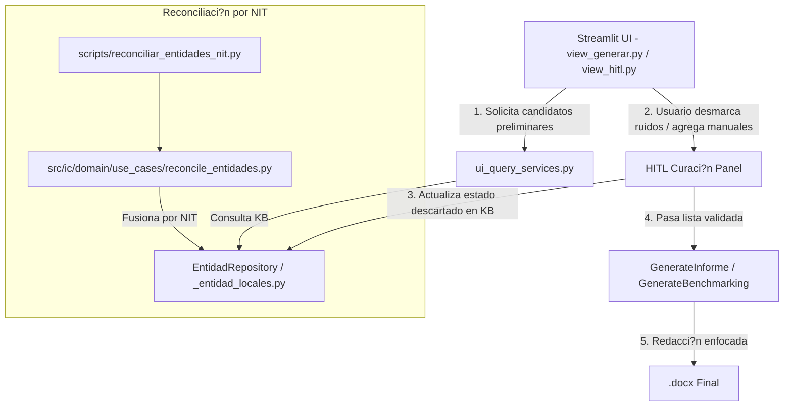

# Implementation Plan: 007 ? Curaci?n Interactiva HITL y Reconciliaci?n de Entidades por NIT

**Branch**: `007-hitl-curacion-reconciliacion-entidades`
**Spec**: [spec.md](spec.md)
**Created**: 2026-09-16
**Status**: Draft

---

## 1. Arquitectura y Componentes Afectados

---

## 2. Cambios Propuestos por Capa

### A. Capa de Datos y Dominio (`src/ic/data/` y `src/ic/domain/`)
- **[NEW] `src/ic/domain/use_cases/reconcile_entidades.py`** (< 250L):
  - L?gica de b?squeda de duplicados por NIT.
  - Selecci?n de entidad can?nica, reasignaci?n de claves for?neas en `entidad_sectores` y `entidad_atributos`, agregaci?n de `aliases`.
  - Borrado seguro de duplicados fusionados.
- **[MODIFY] `src/ic/data/repositories/entidad_repo.py` & `_entidad_queries.py`**:
  - M?todos auxiliares para merge de entidades y marcado de `ESTADO_DESCARTADO`.
- **[NEW] `scripts/reconciliar_entidades_nit.py`** (< 200L):
  - CLI para ejecutar reconciliaci?n de forma interactiva o automatizada con `--dry-run`.

### B. Capa de Presentaci?n (`src/ic/presentation/`)
- **[NEW] `src/ic/presentation/views/view_hitl.py`** (< 250L):
  - Componente de interfaz para pre-validaci?n de competidores:
    - Selector multi-tier: Globales, Regionales, Startups.
    - Acciones por entidad: ? Mantener, ? Descartar (persiste a KB), ? A?adir manual.
    - Bot?n de confirmaci?n para disparar el flujo de generaci?n.
- **[MODIFY] `src/ic/presentation/views/view_generar.py`**:
  - Conexi?n con `view_hitl.py` cuando la casilla de validaci?n previa est? marcada.
- **[MODIFY] `src/ic/domain/use_cases/ui_query_services.py`**:
  - Servicio `fetch_candidatos_preliminares(empresa, sector, ciiu)` y `discard_competidor(entidad_id)`.

---

## 3. Plan de Verificaci?n y Testing

### Tests Automatizados
1. **Tests Unitarios de Reconciliaci?n**:
   - `tests/test_reconcile_entidades.py`: Prueba de fusi?n de atributos, actualizaci?n de aliases, preservaci?n de estado verificado y manejo de casos sin NIT o con NITs duplicados.
2. **Tests de Servicios UI para HITL**:
   - `tests/test_ui_hitl_services.py`: Pruebas para `fetch_candidatos_preliminares` y persistencia de descartes.
3. **Tests de Integraci?n Pipeline + HITL**:
   - Verificar que `GenerateInforme` respete la lista expl?cita de competidores curados sin re-inyectar descartados.

### Verificaci?n de Invariantes
- Ejecutar `find src/ -name "*.py" -exec wc -l {} + | sort -n` para certificar que todos los archivos sigan siendo estrictamente `< 300L`.
- `uv run ruff check .` con 0 errores.
- `uv run pytest -m "not slow and not integration"` en verde.
